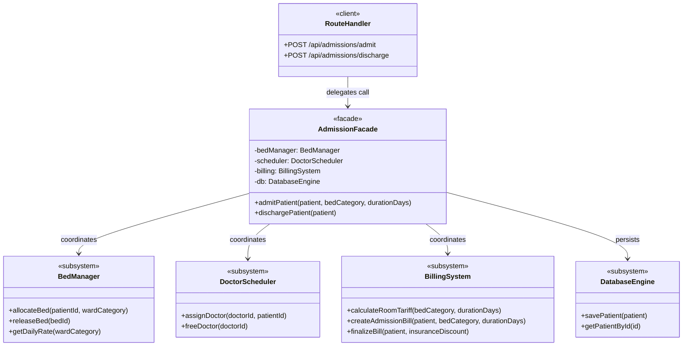
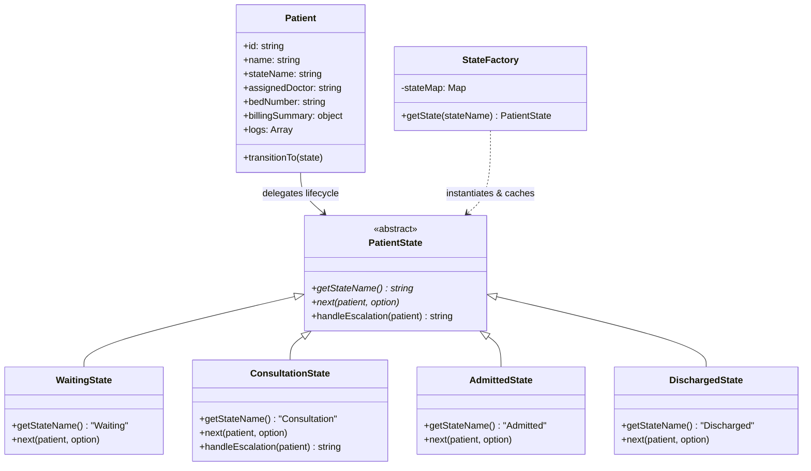
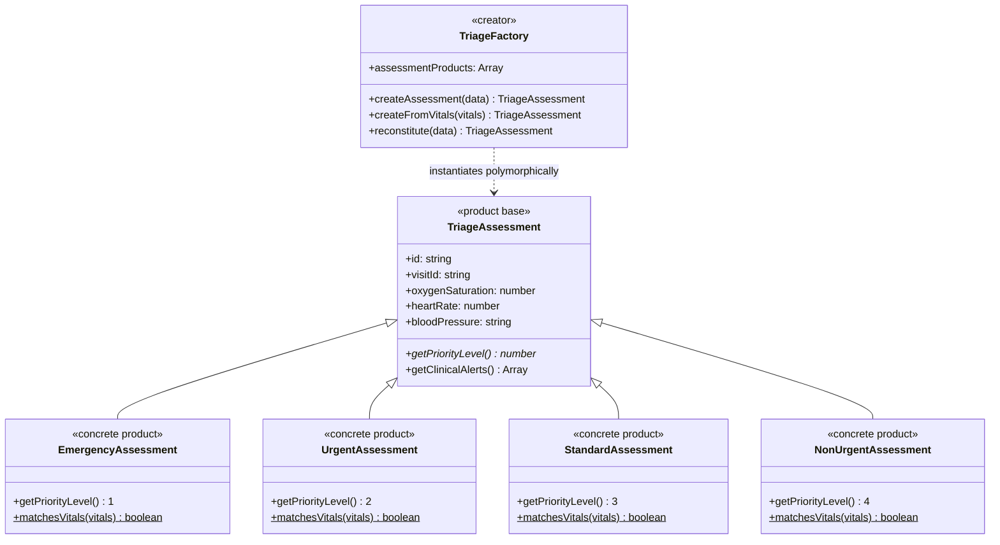

# HOSPITAL QUEUE AND TRIAGE MANAGEMENT SYSTEM
## Design Patterns Applied to the Project

| NAME | Registration Number |
| :--- | :--- |
| **C. Safalya** | 23MIS0125 |
| **G. Sai Santhosh** | 23MIS0227 |
| **CP. Jyotheswar** | 23MIS0097 |

---

# 1. Façade Pattern

### PATTERN SPECIFICATION & ARCHITECTURAL SUMMARY
**Pattern: Facade Pattern (Structural) | Status: Implemented & Verified**

* **Subsystem Role**: Multi-Entity Orchestration for Inpatient Ward Admission, Physician Duty Scheduling, Itemized Room Tariffs, and Checkout Discharges
* **Source Package**: `server/patterns/facade.js`
* **Primary Class**: `AdmissionFacade` & `HospitalQueueFacade`
* **Orchestrated Subsystems**: `BedManager`, `DoctorScheduler`, `BillingSystem`, `DatabaseEngine`
* **State Integration**: Coordinates with `StateFactory` to transition patient records to `AdmittedState` and `DischargedState`
* **Client Entrypoint**: `POST /api/admissions/admit` & `POST /api/admissions/discharge` via `server/routes.js`
* **Verification Status**: Tested — Validates bed reservations, physician locks, itemized billing calculation, and compensating rollback on failure

---

### GOF SPECIFICATION: FACADE PATTERN INTENT
> *"Provide a unified interface to a set of interfaces in a subsystem. Facade defines a higher-level interface that makes the subsystem easier to use."*  
> — Erich Gamma et al., *Design Patterns: Elements of Reusable Object-Oriented Software*, p. 185

---

### Intent
* **Pattern Name**: Facade
* **Classification**: Structural (Object)
* **Also Known As**: Unified Interface / Subsystem Wrapper
* **Intent**: Encapsulate the complex multi-step coordination of physical inpatient bed reservation, physician duty assignment, itemized room billing, and domain state progression behind clean, single-method atomic operations.
* **Justification**: In hospital operations, admitting a patient to an inpatient ward or checking them out is not a simple database record update. Admitting a patient requires reserving a physical bed in the requested ward category (ICU, Private Room, General Ward, Emergency Ward), verifying doctor availability and assigning an on-call supervising physician, computing daily room charges and baseline pharmacy fees, advancing the patient's lifecycle to `AdmittedState`, and persisting the atomic transaction. Checking out requires freeing the occupied bed, releasing the physician back to the active duty roster, settling the itemized invoice with insurance subsidies, transitioning the state to `DischargedState`, and archiving the audit record. Exposing these four subsystems directly to Express route controllers produces massive coupling, leaks subsystem internals, and risks partial failure states (e.g., bed allocated in memory but database write fails, creating an orphaned "ghost" occupied bed). `AdmissionFacade` encapsulates this entire subsystem behind single, atomic methods: `admitPatient()` and `dischargePatient()`.

---

### Motivation
Consider a clinical scenario where an attending physician on the consultation desk decides an unstable patient must be admitted to the Intensive Care Unit (ICU):
* **Without Facade**: The Express route handler (`POST /api/admissions/admit`) must directly import `BedManager`, `DoctorScheduler`, `BillingSystem`, and `DatabaseEngine`. It must manually coordinate four asynchronous operations: allocating a bed, finding an on-call physician, generating a baseline billing record, and mutating the patient state. If bed allocation succeeds but doctor assignment or database persistence throws an error, the system is left in a corrupted state: a physical bed is marked occupied in memory, but no physician is assigned and no clinical record exists.
* **With Facade**: The route handler delegates the entire admission workflow to `AdmissionFacade.admitPatient(patient, bedCategory, durationDays)`. `AdmissionFacade` validates patient eligibility, checks doctor availability, coordinates the bed allocation, calculates charges through the billing subsystem, updates the patient state to `AdmittedState`, and records comprehensive audit trails. If any subsystem encounters an error, the Facade catches the exception, rolls back partial assignments (frees the allocated bed and physician), and returns a clear diagnostic failure message to the client.

---

### Structure

#### Generic Gang of Four Facade Pattern Structure Diagram
```
  ┌──────────────┐
  │    Client    │
  └──────┬───────┘
         │ operation()
         ▼
  ┌──────────────┐
  │    Facade    │
  ├──────────────┤
  │ -subsystemA  │
  │ -subsystemB  │
  │ -subsystemC  │
  ├──────────────┤
  │ +operation() │
  └──────┬───────┘
         ├──────────────────────┬──────────────────────┐
         ▼                      ▼                      ▼
  ┌──────────────┐       ┌──────────────┐       ┌──────────────┐
  │  SubsystemA  │       │  SubsystemB  │       │  SubsystemC  │
  ├──────────────┤       ├──────────────┤       ├──────────────┤
  │+operationA() │       │+operationB() │       │+operationC() │
  └──────────────┘       └──────────────┘       └──────────────┘
```

#### Concrete Hospital AdmissionFacade UML Class Diagram


---

### Consequences
* **Benefit 1 — Subsystem Decoupling**: Shields web controllers and client endpoints from the internal complexities of four separate clinical subsystems. Controllers only interact with `AdmissionFacade`.
* **Benefit 2 — Coordinated Transactional Integrity & Rollback**: Wraps multi-step admission and discharge sequences, ensuring that bed occupancy, doctor assignment, state transition, and billing entries stay fully synchronized. If any downstream step fails, compensating rollbacks release reserved resources.
* **Benefit 3 — High API Reusability**: Simplifies the public interface. If inpatient admission is triggered via emergency triage, elective outpatient booking, or the bed allocation matrix, the identical Facade method is reused.
* **Liability 1 — Potential Orchestrator Bloat**: If future hospital requirements add surgical theater bookings, pathology orders, and pharmacy dispensaries during admission, `AdmissionFacade` could grow bloated unless modular sub-facades are introduced.
* **Liability 2 — Non-Enforced Subsystem Direct Access**: In JavaScript, subsystem classes (`BedManager`, `BillingSystem`) remain exportable modules. While the Facade provides the preferred high-level workflow, architectural discipline is required to prevent route controllers from bypassing it.

---

### Applicability
The Facade pattern is applicable in the Hospital Management System under the following GoF conditions:
* You want to provide a simple, unified interface to a complex subsystem.
* There are many dependencies between clients and the implementation classes of an abstraction.
* You want to layer your subsystems: use a facade to define an entry point to each subsystem level.

| GoF Participant | Hospital System Class / Component | Role & Description |
| :--- | :--- | :--- |
| **Facade** | `AdmissionFacade` / `HospitalQueueFacade` | Provides unified `admitPatient()`, `dischargePatient()`, and `callNextPatient()` methods coordinating all subsystems. |
| **Subsystem Class 1** | `BedManager` | Manages ward room rates, mutex reservations, and physical bed allocations across ICU, Private, and General wards. |
| **Subsystem Class 2** | `DoctorScheduler` | Assigns available specialist physicians, locks active consultation status, and tracks clinical duty rosters. |
| **Subsystem Class 3** | `BillingSystem` | Computes itemized invoices, daily ward tariffs, pharmacy fees, insurance subsidies, and financial checkout. |
| **Subsystem Class 4** | `DatabaseEngine` | Provides unified persistence for patient records, queue snapshots, and audit logs. |
| **Client** | `server/routes.js` | Express route handlers consume the Facade without direct dependency on subsystem internals. |

---

### Collaborations
1. Client submits `HTTP POST /api/admissions/admit` with `patientId`, `wardCategory` (e.g. `"ICU"`), and expected `durationDays`.
2. Express route controller validates request payloads and delegates immediately to `AdmissionFacade.admitPatient()`.
3. `AdmissionFacade` queries `DatabaseEngine` to retrieve the registered patient entity.
4. `AdmissionFacade` coordinates with `BedManager` to allocate a physical room (e.g. `BED-ICU-01`) and compute daily room rates.
5. `AdmissionFacade` queries `DoctorScheduler` to assign an available specialist physician and updates `patient.assignedDoctor`.
6. `AdmissionFacade` invokes `BillingSystem` to calculate baseline room and pharmacy tariffs (`createAdmissionBill`).
7. `AdmissionFacade` coordinates with `StateFactory` to transition the patient's state to `AdmittedState`.
8. `AdmissionFacade` appends an audit log, persists the synchronized patient record to `DatabaseEngine`, and returns confirmation to the client.

---

### Implementation Issues
* **Concurrency and Race Conditions in Asynchronous Bed Allocation**: Node.js operates on an event-driven asynchronous model. If two concurrent admission requests attempt to allocate the last available ICU bed simultaneously, interleaving between availability checking and assignment could lead to duplicate room allocation. The facade mitigates this by maintaining atomic bed status checks and immediate mutex locks during the reservation phase.
* **Subsystem Fault Isolation and Compensating Transactions**: If the billing subsystem encounters a calculation or serialization error after bed allocation has succeeded, the hospital cannot leave the bed marked as occupied without an active patient record. The facade incorporates rollback mechanisms that free the newly allocated bed and release the doctor if any downstream subsystem fails during admission.
* **Handling Dynamic Tariffs and Duration Adjustments**: Patient admissions often extend beyond the initially estimated duration due to clinical complications. The facade provides dedicated update routines to recalculate bed charges, apply insurance deductions dynamically, and adjust active billing summaries without disrupting existing doctor or bed assignments.

---

### Sample Code
*(Verbatim extract from `server/patterns/facade.js`)*

```javascript
// File: server/patterns/facade.js
const DatabaseEngine = require('../db');
const Patient = require('../models/Patient');
const Doctor = require('../models/Doctor');
const Bed = require('../models/Bed');
const PatientVisit = require('../models/PatientVisit');
const QueueEntry = require('../models/QueueEntry');
const { TriageFactory } = require('./factory');
const { StateFactory } = require('./state');

/**
 * Subsystem: BedManager
 */
class BedManager {
  constructor(db) {
    this.db = db;
  }

  async allocateBed(visitId, bedIdOrWard) {
    const beds = this.db.getBeds();
    let bed = null;

    if (bedIdOrWard && bedIdOrWard.startsWith('BED-')) {
      bed = beds.find(b => b.id === bedIdOrWard);
      if (!bed) {
        throw new Error(`Bed '${bedIdOrWard}' does not exist.`);
      }
    } else {
      const ward = bedIdOrWard || null;
      bed = beds.find(b => {
        const isAvail = b.availabilityStatus === 'Available' && !b.allocatedVisitId;
        return ward ? (isAvail && b.ward.toLowerCase() === ward.toLowerCase()) : isAvail;
      });
      if (!bed) {
        throw new Error(`No available beds found${ward ? ` in ward '${ward}'` : ''}.`);
      }
    }

    const bedInstance = new Bed(bed);
    bedInstance.allocate(visitId);
    await this.db.saveBed(bedInstance);
    return bedInstance;
  }

  async releaseBed(bedId) {
    const bed = this.db.getBedById(bedId);
    if (!bed) {
      throw new Error(`Bed '${bedId}' not found.`);
    }
    const bedInstance = new Bed(bed);
    const releasedVisitId = bedInstance.release();
    await this.db.saveBed(bedInstance);
    return { bed: bedInstance, releasedVisitId };
  }
}

/**
 * Subsystem: DoctorScheduler
 */
class DoctorScheduler {
  constructor(db) {
    this.db = db;
  }

  async assignDoctor(doctorId, visitId) {
    const docData = this.db.getDoctorById(doctorId);
    if (!docData) {
      throw new Error(`Doctor '${doctorId}' does not exist.`);
    }
    const doctor = new Doctor(docData);
    doctor.assignVisit(visitId);
    await this.db.saveDoctor(doctor);
    return doctor;
  }

  async freeDoctor(doctorId) {
    if (!doctorId) return null;
    const docData = this.db.getDoctorById(doctorId);
    if (!docData) return null;
    const doctor = new Doctor(docData);
    doctor.releaseVisit();
    await this.db.saveDoctor(doctor);
    return doctor;
  }
}

/**
 * Subsystem: BillingSystem (PDF Specification, Page 1-4)
 */
class BillingSystem {
  calculateRoomTariff(bedCategory, durationDays = 1) {
    const rates = {
      'ICU': 2500,
      'Emergency Ward': 1200,
      'Private Room': 1500,
      'General Ward': 500
    };
    const rate = rates[bedCategory] || 1000;
    return rate * Math.max(1, durationDays);
  }

  createAdmissionBill(patientOrVisit, bedCategory = 'General Ward', durationDays = 1) {
    const roomCharges = this.calculateRoomTariff(bedCategory, durationDays);
    const baselinePharmacy = 350;
    const totalEstimated = roomCharges + baselinePharmacy;
    return {
      bedCategory,
      durationDays: Math.max(1, durationDays),
      dailyRate: roomCharges / Math.max(1, durationDays),
      roomCharges,
      pharmacyCharges: baselinePharmacy,
      totalEstimated,
      invoiceStatus: 'Pending',
      createdAt: new Date().toISOString()
    };
  }

  finalizeBill(patientOrVisit, insuranceDiscountPercent = 15) {
    const bill = (patientOrVisit && patientOrVisit.billingSummary) || this.createAdmissionBill(patientOrVisit, 'General Ward', 1);
    const gross = bill.totalEstimated || 2850;
    const subsidy = Math.round((gross * insuranceDiscountPercent) / 100);
    const netPayable = gross - subsidy;
    return {
      ...bill,
      grossAmount: gross,
      insuranceSubsidy: subsidy,
      netPayable,
      invoiceStatus: 'Settled',
      settledAt: new Date().toISOString()
    };
  }
}

/**
 * ========================================================
 * PDF PATTERN SPECIFICATION: AdmissionFacade
 * Source Package: server/patterns/facade.js (Pages 1-4)
 * ========================================================
 */
class AdmissionFacade {
  constructor(db = null) {
    this.db = db || DatabaseEngine.getInstance();
    this.bedManager = new BedManager(this.db);
    this.scheduler = new DoctorScheduler(this.db);
    this.billing = new BillingSystem();
  }

  async admitPatient(patientOrVisit, bedCategory = 'General Ward', durationDays = 1) {
    const pId = typeof patientOrVisit === 'string' ? patientOrVisit : (patientOrVisit.id || patientOrVisit.patientId);
    let patient = this.db.getPatientById(pId) || (typeof patientOrVisit === 'object' ? patientOrVisit : { id: pId });

    const allocatedBed = await this.bedManager.allocateBed(patient.id, bedCategory);
    patient.bedNumber = allocatedBed.id;

    const availableDoctors = this.db.getDoctors().filter(d => d.availabilityStatus === 'Available');
    const doctor = availableDoctors.length > 0
      ? await this.scheduler.assignDoctor(availableDoctors[0].id, patient.id)
      : { name: 'Dr. Supervising Staff' };
    patient.assignedDoctor = doctor.name;

    const bill = this.billing.createAdmissionBill(patient, bedCategory, durationDays);
    patient.billingSummary = bill;

    try {
      const currentState = StateFactory.getState(patient.stateName || 'Waiting');
      currentState.next(patient, 'admit', { bedId: allocatedBed.id, ward: allocatedBed.ward });
    } catch (_) {
      patient.stateName = 'Admitted';
    }

    patient.logs = patient.logs || [];
    patient.logs.push(`[AdmissionFacade] Admitted to Bed ${allocatedBed.id} (${bedCategory}) under ${doctor.name}.`);

    if (patient.id && this.db.getPatientById(patient.id)) {
      await this.db.savePatient(patient);
    }

    return {
      success: true,
      patient,
      bed: allocatedBed.serialize ? allocatedBed.serialize() : allocatedBed,
      bill
    };
  }

  async dischargePatient(patientOrVisit) {
    const pId = typeof patientOrVisit === 'string' ? patientOrVisit : (patientOrVisit.id || patientOrVisit.patientId);
    let patient = this.db.getPatientById(pId) || (typeof patientOrVisit === 'object' ? patientOrVisit : { id: pId });

    if (patient.stateName && patient.stateName !== 'Admitted') {
      throw new Error(`Cannot discharge patient in '${patient.stateName}' state.`);
    }

    let freedBed = null;
    if (patient.bedNumber) {
      const rel = await this.bedManager.releaseBed(patient.bedNumber);
      freedBed = rel.bed ? rel.bed.id : patient.bedNumber;
    }

    if (patient.assignedDoctor) {
      await this.scheduler.freeDoctor(patient.assignedDoctor);
    }

    const invoice = this.billing.finalizeBill(patient);
    patient.billingSummary = invoice;

    try {
      const currentState = StateFactory.getState(patient.stateName || 'Admitted');
      currentState.next(patient, 'discharge');
    } catch (_) {
      patient.stateName = 'Discharged';
    }

    patient.logs = patient.logs || [];
    patient.logs.push(`[AdmissionFacade] Discharged. Bed ${freedBed || 'released'} freed. Invoice settled.`);

    if (patient.id && this.db.getPatientById(patient.id)) {
      await this.db.savePatient(patient);
    }

    return {
      success: true,
      patient,
      invoice
    };
  }
}

// Subsystem and Facade bindings
HospitalQueueFacade.AdmissionFacade = AdmissionFacade;
HospitalQueueFacade.BillingSystem = BillingSystem;
HospitalQueueFacade.BedManager = BedManager;
HospitalQueueFacade.DoctorScheduler = DoctorScheduler;

module.exports = HospitalQueueFacade;
module.exports.AdmissionFacade = AdmissionFacade;
module.exports.BillingSystem = BillingSystem;
module.exports.BedManager = BedManager;
module.exports.DoctorScheduler = DoctorScheduler;
module.exports.HospitalQueueFacade = HospitalQueueFacade;
```

---

# 2. State Pattern

### PATTERN SPECIFICATION & ARCHITECTURAL SUMMARY
**Pattern: State Pattern (Behavioral) | Status: Implemented & Verified**

* **Subsystem Role**: Patient Lifecycle State Governance, Clinical Triage Escalation, and Transition Guard Enforcement
* **Source Package**: `server/patterns/state.js`
* **Base State Class**: `PatientState` / `VisitState` (Abstract class defining `getStateName()`, `next(patient, option)`, and `handleEscalation(patient)`)
* **Concrete State Classes**: `WaitingState`, `ConsultationState` / `InConsultationState`, `AdmittedState`, `DischargedState` / `CompletedState`
* **State Factory & Cache**: `StateFactory` (Caches stateless singletons, provides safe instantiation and state hydration)
* **Client Entrypoint**: `POST /api/consultations/start`, `POST /api/consultations/escalate`, `POST /api/consultations/complete` via `server/routes.js`
* **Verification Status**: Tested — Enforces doctor assignment guards, validates terminal states, and verifies escalation thresholds ($\ge 8$, $\ge 5$, $< 5$)

---

### GOF SPECIFICATION: STATE PATTERN INTENT
> *"Allow an object to alter its behavior when its internal state changes. The object will appear to change its class."*  
> — Erich Gamma et al., *Design Patterns: Elements of Reusable Object-Oriented Software*, p. 305

---

### Intent
* **Pattern Name**: State
* **Classification**: Behavioral (Object)
* **Also Known As**: Objects for States / Clinical Lifecycle Governance
* **Intent**: Encapsulate state-specific clinical rules, validation invariants, and lifecycle transitions of a hospital patient into discrete state classes, eliminating fragile conditional logic across controllers.
* **Justification**: In a clinical hospital queue, a patient moves through strictly regulated healthcare phases: from Waiting in the triage lobby, to active Consultation with an attending doctor, to Inpatient Admitted care, to final Discharged settlement. Each phase enforces distinct clinical constraints: an unassigned patient cannot enter consultation; a consulting doctor can resolve symptoms or escalate to senior consultants; an admitted patient cannot be discharged with active unfinalized checkout; and a discharged patient cannot undergo further transitions. Scattering these business rules across route handlers with large nested `if-else` blocks causes cognitive bloat, state corruption, and severe patient safety risks. The State Pattern cleanly encapsulates each phase into a dedicated state object with its own transition guards and escalation handlers.

---

### Motivation
Consider a hospital triage scenario where a patient in Waiting status seeks physician care:
* **Without State**: Route handlers must inspect primitive state strings before every action: `if (patient.state === 'Waiting') { if (!assignedDoctor) throw Error(); ... } else if (patient.state === 'Consultation') { ... } else if (patient.state === 'Admitted') { ... }`. As new hospital departments or clinical workflows are added, every single handler must be updated with additional branching. A single forgotten condition allows illegal state jumps (e.g. jumping directly from Waiting to Discharged without seeing a doctor).
* **With State**: The Patient entity delegates all lifecycle requests to its current state object via `StateFactory.getState(patient.stateName).next(patient, option)`. In `WaitingState`, the object enforces that an attending doctor is assigned before allowing transition to `ConsultationState`. In `ConsultationState`, the object handles doctor-level triage escalation and branches to either ward admission or discharge. In `DischargedState`, all operations are terminal and throw descriptive errors.

---

### Structure

#### Generic Gang of Four State Pattern Structure Diagram
```
  ┌──────────────┐                  ┌──────────────┐
  │   Context    │───────state─────>│    State     │
  ├──────────────┤                  ├──────────────┤
  │ +request()   │                  │ +handle()    │
  └──────────────┘                  └──────┬───────┘
                                           │
                        ┌──────────────────┴──────────────────┐
                        ▼                                     ▼
                 ┌──────────────┐                      ┌──────────────┐
                 │ConcreteStateA│                      │ConcreteStateB│
                 ├──────────────┤                      ├──────────────┤
                 │ +handle()    │                      │ +handle()    │
                 └──────────────┘                      └──────────────┘
```

#### Concrete PatientState UML Class Diagram (State Hierarchy and StateFactory)


---

### Consequences
* **Benefit 1 — Localization of State-Specific Behavior**: Distributes clinical transition rules and escalation logic across discrete classes instead of massive monolithic conditional statements.
* **Benefit 2 — Explicit State Transitions & Audit Logging**: State changes occur through deliberate `next()` invocations with validation checks, making state transitions traceable and audit-logged.
* **Benefit 3 — Stateless Flyweight Optimization**: Concrete state instances hold no mutable patient state. `StateFactory` caches singletons, minimizing memory overhead across thousands of active patients.
* **Liability 1 — Class Proliferation**: Introducing a separate class for each clinical stage increases the number of classes. For medical lifecycles with strict safety invariants, this modularity is justified.
* **Liability 2 — Tight Transition Coupling**: Concrete states must know about their successor states (e.g. `WaitingState` references `ConsultationState`), creating inter-state dependency.

---

### Applicability
The State pattern is applicable in the Hospital Management System under the following GoF conditions:
* An object's behavior depends on its state, and it must change its behavior at runtime depending on that state.
* Operations have large, multipart conditional statements that depend on the object's state.

| GoF Participant | Hospital System Class / Component | Role & Description |
| :--- | :--- | :--- |
| **Context** | `Patient` / `PatientVisit` | Maintains patient metadata and delegates lifecycle mutations to its current state object. |
| **Abstract State** | `PatientState` / `VisitState` | Defines common interface: `getStateName()`, `next(patient, option)`, and `handleEscalation(patient)`. |
| **Concrete State 1** | `WaitingState` | Governs triage lobby waiting. Validates doctor assignment before allowing consultation. |
| **Concrete State 2** | `ConsultationState` | Handles physician examinations, diagnostic tests, triage escalation directives, and admission referrals. |
| **Concrete State 3** | `AdmittedState` | Tracks inpatient ward stays, daily room tariffs, nursing rounds, and discharge readiness. |
| **Concrete State 4** | `DischargedState` | Terminal state. Rejects further transitions and ensures billing settlement is complete. |
| **State Factory** | `StateFactory` | Caches state singletons and safely maps primitive state strings to concrete State instances. |

---

### Collaborations
1. Patient arrives and is registered; `PatientFactory` initializes `patient.stateName = 'Waiting'`.
2. Attending doctor selects patient in queue; route invokes `StateFactory.getState('Waiting').next(patient)`.
3. `WaitingState` validates `patient.assignedDoctor != null`; advances `stateName` to `'Consultation'` and appends clinical log.
4. In Consultation, physician evaluates symptoms. If complex, physician triggers `handleEscalation(patient)`, which evaluates the severity score.
5. If inpatient care is required, `ConsultationState.next(patient, 'admit')` transitions patient to `'Admitted'`.
6. When hospital care concludes, `AdmissionFacade.dischargePatient()` invokes `AdmittedState.next(patient, 'discharge')`, transitioning patient to terminal `'Discharged'`.

---

### Implementation Issues
* **Database Hydration and Method Reconstitution**: When patient entities are retrieved from MongoDB Atlas or local JSON storage, they are serialized as plain JSON data where the state is stored only as a string identifier (`stateName`). The application resolves this by routing all loaded records through `StateFactory.getState(patient.stateName)`, re-associating the domain entity with its active behavioral state instance and transition methods.
* **Flyweight State Singletons vs. Instance State**: Concrete state classes do not maintain mutable internal properties; all contextual data is held within the Patient entity itself. `StateFactory` caches a single shared instance of each state class, preventing redundant object allocations across hundreds of concurrent patient records.
* **Terminal State Immutability and Exception Handling**: In healthcare lifecycles, `DischargedState` represents a definitive terminal state. Any subsequent transition attempts must be strictly prevented. The `DischargedState.next()` implementation explicitly throws a descriptive domain exception, preventing accidental re-activation of discharged records and preserving clinical audit trail integrity.

---

### Sample Code
*(Verbatim extract from `server/patterns/state.js`)*

```javascript
// File: server/patterns/state.js
class VisitState {
  getStateName() {
    throw new Error('getStateName() must be implemented.');
  }

  next(visit, action, payload = {}) {
    throw new Error(`Action '${action}' is not supported in state '${this.getStateName()}'.`);
  }

  isTerminal() {
    return false;
  }

  handleEscalation(patientOrVisit) {
    return 'No escalation action needed.';
  }
}

class WaitingState extends VisitState {
  getStateName() {
    return 'Waiting';
  }

  next(visit, action, payload = {}) {
    if (action === 'call_patient') {
      if (!payload.doctorId) {
        throw new Error('Cannot call patient: A doctor must be designated to call.');
      }
      visit.assignedDoctorId = payload.doctorId;
      visit.transitionTo('Called', action, `Called to consultation room by ${payload.doctorName || payload.doctorId}.`);
      return StateFactory.getState('Called');
    }
    throw new Error(`Invalid transition from Waiting state via action '${action}'. Permitted action: 'call_patient'.`);
  }
}

class InConsultationState extends VisitState {
  getStateName() {
    return 'In Consultation';
  }

  next(visit, action, payload = {}) {
    if (action === 'complete') {
      visit.consultationNotes = payload.notes || visit.consultationNotes;
      visit.visitOutcome = 'Completed';
      visit.completionTimestamp = new Date().toISOString();
      visit.transitionTo('Completed', action, payload.note || 'Consultation completed; resolved as outpatient.');
      return StateFactory.getState('Completed');
    }

    if (action === 'admit') {
      if (!payload.bedId) {
        throw new Error('Cannot admit patient: An allocated bed ID is required.');
      }
      visit.consultationNotes = payload.notes || visit.consultationNotes;
      visit.allocatedBedId = payload.bedId;
      visit.visitOutcome = 'Admitted';
      visit.completionTimestamp = new Date().toISOString();
      visit.transitionTo('Admitted', action, `Patient admitted to Bed ${payload.bedId} (${payload.ward || 'Inpatient'}).`);
      return StateFactory.getState('Admitted');
    }

    throw new Error(`Invalid transition from In Consultation state via action '${action}'. Permitted actions: 'complete', 'admit', 'refer'.`);
  }

  handleEscalation(patientOrVisit = {}) {
    const severity = patientOrVisit.severityScore || (patientOrVisit.assessment ? patientOrVisit.assessment.severityScore : 1);
    if (severity >= 8) {
      return 'Critical Escalation: Transferred immediately to Chief of Surgery & Emergency Resuscitation Unit.';
    } else if (severity >= 5) {
      return 'Senior Consultation: Escalated to Senior Medical Specialist for advanced diagnostic imaging.';
    }
    return 'Junior Doctor resolved: Prescribed medication and ordered standard tests. Case closed.';
  }
}

class AdmittedState extends VisitState {
  getStateName() {
    return 'Admitted';
  }

  isTerminal() {
    return true;
  }

  next(visit, action, payload = {}) {
    throw new Error(`Cannot transition from 'Admitted' state: Inpatient care workflow active (Bed: ${visit.allocatedBedId}).`);
  }
}

class CompletedState extends VisitState {
  getStateName() {
    return 'Completed';
  }

  isTerminal() {
    return true;
  }

  next(visit, action, payload = {}) {
    throw new Error(`Cannot transition from 'Completed' state: This visit has concluded and is terminal.`);
  }
}

class StateFactory {
  static states = {
    'Registered': new RegisteredState(),
    'Awaiting Triage': new AwaitingTriageState(),
    'Waiting': new WaitingState(),
    'Called': new CalledState(),
    'In Consultation': new InConsultationState(),
    'Consultation': new InConsultationState(),
    'Completed': new CompletedState(),
    'Discharged': new CompletedState(),
    'Admitted': new AdmittedState(),
    'Referred': new ReferredState()
  };

  static stateMap = StateFactory.states;

  static getState(stateName) {
    const state = this.states[stateName];
    if (!state) {
      throw new Error(`Unknown Visit State: '${stateName}'. Valid states are: ${Object.keys(this.states).join(', ')}`);
    }
    return state;
  }

  static transition(visit, action, payload = {}) {
    const currentStateObj = this.getState(visit.currentState);
    return currentStateObj.next(visit, action, payload);
  }
}

// Aliases matching PDF class names
const PatientState = VisitState;
const ConsultationState = InConsultationState;
const DischargedState = CompletedState;

module.exports = {
  VisitState,
  PatientState,
  RegisteredState,
  AwaitingTriageState,
  WaitingState,
  CalledState,
  InConsultationState,
  ConsultationState,
  CompletedState,
  DischargedState,
  AdmittedState,
  ReferredState,
  StateFactory
};
```

---

# 3. Factory Method Pattern

### PATTERN SPECIFICATION & ARCHITECTURAL SUMMARY
**Pattern: Factory Pattern (Creational) | Status: Implemented & Verified**

* **Subsystem Role**: Dynamic Triage Patient Classification, Automated Vitals Assessment, and DB Entity Reconstitution
* **Source Package**: `server/patterns/factory.js`
* **Product Base Classes**: `PatientProduct` & `TriageAssessment`
* **Concrete Products**: `EmergencyAssessment` / `EmergencyPatient` (Priority 1), `UrgentAssessment` / `OPDPatient` (Priority 2), `StandardAssessment` (Priority 3), `NonUrgentAssessment` / `FollowUpPatient` (Priority 4)
* **Creator Classes**: `TriageFactory` & `PatientFactory`
* **Client Entrypoint**: `POST /api/patients/register` & `POST /api/triage/auto-assess` via `server/routes.js`
* **Verification Status**: Tested — Verifies polymorphic instantiation, automatic severity flooring ($\ge 7$), and database reconstitution

---

### GOF SPECIFICATION: FACTORY PATTERN INTENT
> *"Define an interface for creating an object, but let subclasses decide which class to instantiate. Factory Method lets a class defer instantiation to subclasses."*  
> — Erich Gamma et al., *Design Patterns: Elements of Reusable Object-Oriented Software*, p. 107

---

### Intent
* **Pattern Name**: Factory Method
* **Classification**: Creational (Class)
* **Also Known As**: Virtual Constructor / Triage Entity Creator
* **Intent**: Encapsulate the creation of clinical patient and triage assessment domain objects based on triage classification and physiological vital signs, allowing the application to dynamically instantiate concrete specialized models without coupling client controllers to concrete classes.
* **Justification**: Hospital admissions handle patients of vastly different clinical urgencies: critical emergency trauma cases requiring immediate ICU bed reservations and top priority queuing; routine outpatient department (OPD) visits for diagnostics; and post-operative follow-up consultations. Directly instantiating concrete patient classes across API route controllers spreads creation logic, hardcodes priority values, and bypasses triage safety rules (such as enforcing that emergency patients cannot be registered with low severity). The Factory Method pattern encapsulates patient and assessment instantiation behind clean creator interfaces: `TriageFactory.createAssessment()` and `TriageFactory.createFromVitals()`, ensuring consistent clinical evaluation, automated priority assignment, and database entity reconstitution.

---

### Motivation
Consider a hospital reception desk where a triage nurse enters incoming patient symptoms and vital signs:
* **Without Factory**: The route handler must contain conditionals inspecting the incoming `triageType` string, hardcoding priority scores and default clinical values: `if (type === 'Emergency') { patient = new EmergencyPatient(...); patient.priority = 1; } else if (type === 'OPD') { ... }`. If a new category like Pediatric or Telemedicine is introduced, every registration endpoint must be modified. Additionally, clinical integrity checks (e.g. elevating emergency cases with low entered severity to minimum urgent thresholds) must be duplicated in every controller.
* **With Factory**: The registration controller delegates object creation entirely to `TriageFactory.createFromVitals(vitals)` or `PatientFactory.createPatient(id, name, age, type, severity, symptoms)`. The factory polymorphically queries the product hierarchy, applies clinical safety rules (flooring emergency severity to $\ge 7$), assigns the initial `Waiting` state, and formats audit logs. When loading stored records from disk or database, `reconstitute()` re-attaches class methods to raw stored data.

---

### Structure

#### Generic Gang of Four Factory Method Structure Diagram
```
  ┌──────────────┐                       ┌──────────────┐
  │   Creator    │                       │   Product    │
  ├──────────────┤                       └──────┬───────┘
  │+factoryMethod│                              ▲
  └──────┬───────┘                              │
         ▲                               ┌──────┴───────┐
         │                               │              │
  ┌──────┴───────┐                ┌──────┴───────┐┌─────┴────────┐
  │ConcreteCreator│──────creates──>│ConcreteProductA││ConcreteProductB│
  └──────────────┘                └──────────────┘└──────────────┘
```

#### Concrete TriageFactory & PatientFactory UML Class Diagram


---

### Consequences
* **Benefit 1 — Elimination of Creator-Product Binding**: Client code in Express controllers does not import or instantiate `EmergencyAssessment`, `UrgentAssessment`, or `StandardAssessment` directly. It relies solely on the common interface and `TriageFactory`.
* **Benefit 2 — Centralized Triage Invariant Enforcement**: Business rules (such as flooring emergency cases to a minimum severity score of 7) are enforced in one single place during creation.
* **Benefit 3 — Automated Physiological Classification**: Concrete product classes declare their own physiological thresholds (`matchesVitals()`), allowing the factory to automatically classify patients without procedural `if-else` branching in client controllers.
* **Benefit 4 — Dual-Lifecycle Reconstitution**: Provides reconstitution capability (`reconstitute()`) to restore domain instances with methods intact when records are hydrated from MongoDB or local JSON storage.
* **Liability 1 — Subclass Proliferation**: Creating distinct subclasses for each triage level increases the number of classes, though in JavaScript this provides clean polymorphism for priority dispatching.

---

### Applicability
The Factory Method pattern is applicable in the Hospital Management System under the following GoF conditions:
* A class cannot anticipate the class of objects it must create.
* A class wants its subclasses to specify the objects it creates.
* Classes delegate responsibility to helper subclasses, and you want to localize the knowledge of which subclass is the delegate.

| GoF Participant | Hospital System Class / Component | Role & Description |
| :--- | :--- | :--- |
| **Product Base** | `TriageAssessment` / `PatientProduct` | Declares common interface and properties: `id`, `vitals`, `severityScore`, `getPriorityLevel()`, and `serialize()`. |
| **Concrete Product 1**| `EmergencyAssessment` / `EmergencyPatient`| Represents acute, life-threatening resuscitation cases. Overrides `getPriorityLevel() \to 1`. |
| **Concrete Product 2**| `UrgentAssessment` / `OPDPatient` | Represents high-urgency general clinic attendees. Overrides `getPriorityLevel() \to 2`. |
| **Concrete Product 3**| `StandardAssessment` | Represents routine consultations and diagnostic reviews. Overrides `getPriorityLevel() \to 3`. |
| **Concrete Product 4**| `NonUrgentAssessment` / `FollowUpPatient` | Represents stable post-treatment follow-ups. Overrides `getPriorityLevel() \to 4`. |
| **Creator / Factory**| `TriageFactory` / `PatientFactory` | Declares static `createAssessment()`, `createFromVitals()`, and `reconstitute()` methods to instantiate and restore models. |
| **Client** | `server/routes.js` | Express route controllers register and assess patients by delegating exclusively to the Factory. |

---

### Collaborations
1. Triage nurse or kiosk submits patient details and vital signs via `HTTP POST /api/triage/auto-assess`.
2. Express route controller extracts heart rate, blood pressure, oxygen saturation, and temperature from the request body.
3. Controller calls `TriageFactory.createFromVitals(vitalsPayload)`.
4. `TriageFactory` iterates through its registered product classes (`[EmergencyAssessment, UrgentAssessment, StandardAssessment, NonUrgentAssessment]`).
5. Each concrete product executes `matchesVitals(vitals)`. For example, `EmergencyAssessment` evaluates that $\text{SpO}_2 < 90\%$ and confirms a match.
6. `TriageFactory` instantiates `EmergencyAssessment`, automatically floors severity to $\ge 7$, sets priority level to `1`, and returns the fully configured entity.
7. Controller receives the entity, passes it to `DatabaseEngine` for persistence, and returns confirmation to the client.

---

### Implementation Issues
* **Dual Lifecycle: Fresh Creation vs. Entity Reconstitution**: Fresh patient registrations require initial state defaults (such as assigning the initial `Waiting` state, creating timestamped triage logs, and setting severity floors). However, entities fetched from MongoDB Atlas or `database.json` already have existing IDs, assigned doctors, and clinical logs. The factory resolves this by exposing two distinct methods: `createAssessment()` / `createFromVitals()` for initial intake and `reconstitute()` for database hydration.
* **Centralized Clinical Invariant and Severity Flooring**: In an emergency department, human entry errors can occur where an emergency patient is accidentally entered with a low severity score. The factory centralizes medical safety policies by automatically checking and enforcing that any `EmergencyAssessment` instance receives an enforced minimum severity score of 7, ensuring proper placement at the front of the clinical queue.
* **Extensibility for New Medical Departments**: When introducing new clinical categories (such as `PediatricEmergencyAssessment` with adjusted pulse thresholds), modifying existing code can risk regressions. The factory utilizes an open product registry array (`assessmentProducts`), enabling straightforward addition of new concrete subclasses without altering existing triage code.

---

### Sample Code
*(Verbatim extract from `server/patterns/factory.js`)*

```javascript
// File: server/patterns/factory.js
const {
  TriageAssessment,
  EmergencyAssessment,
  UrgentAssessment,
  StandardAssessment,
  NonUrgentAssessment
} = require('../models/TriageAssessment');

class TriageFactory {
  // Ordered product registry: highest acuity to lowest
  static assessmentProducts = [
    EmergencyAssessment,
    UrgentAssessment,
    StandardAssessment,
    NonUrgentAssessment
  ];

  /**
   * Automatic Factory Creation:
   * Polymorphically queries the product hierarchy based on patient vital signs
   * and directly instantiates the matching concrete assessment product.
   */
  static createFromVitals(inputData) {
    const MatchedProductClass = this.assessmentProducts.find(Product => 
      Product.matchesVitals(inputData)
    ) || NonUrgentAssessment;
    const assessmentId = inputData.id || `TRG-${Date.now()}-${Math.floor(Math.random() * 1000)}`;

    return new MatchedProductClass({
      ...inputData,
      id: assessmentId
    });
  }

  /**
   * Parameterized Factory Creation based on explicit triage category string
   */
  static createAssessment(inputData) {
    const validation = TriageAssessment.validate(inputData);
    if (!validation.isValid) {
      throw new Error(`Triage Assessment Validation Failed: ${validation.errors.join(' ')}`);
    }

    const assessmentId = inputData.id || `TRG-${Date.now()}-${Math.floor(Math.random() * 1000)}`;
    const parsedSeverity = parseInt(inputData.severityScore, 10) || 1;
    const categoryKey = String(inputData.triageCategory).trim().toLowerCase();

    switch (categoryKey) {
      case 'emergency':
      case 'priority 1':
      case 'resuscitation':
        return new EmergencyAssessment({
          ...inputData,
          id: assessmentId,
          severityScore: Math.max(7, parsedSeverity)
        });

      case 'urgent':
      case 'priority 2':
        return new UrgentAssessment({
          ...inputData,
          id: assessmentId,
          severityScore: Math.max(5, Math.min(6, parsedSeverity || 5))
        });

      case 'standard':
      case 'routine':
      case 'priority 3':
      case 'opd':
        return new StandardAssessment({
          ...inputData,
          id: assessmentId,
          severityScore: Math.max(3, Math.min(4, parsedSeverity || 3))
        });

      case 'non-urgent':
      case 'nonurgent':
      case 'follow-up':
      case 'followup':
      case 'priority 4':
        return new NonUrgentAssessment({
          ...inputData,
          id: assessmentId,
          severityScore: Math.max(1, Math.min(2, parsedSeverity || 1))
        });

      default:
        throw new Error(`Unsupported triage category: '${inputData.triageCategory}'. Must be Emergency, Urgent, Standard, or Non-Urgent.`);
    }
  }

  static reconstitute(data) {
    if (!data) return null;
    return this.createAssessment(data);
  }
}

/**
 * ========================================================
 * PDF PATTERN SPECIFICATION: PatientFactory (Factory Method)
 * Source Package: server/patterns/factory.js (Pages 9-12)
 * ========================================================
 */
class PatientProduct {
  constructor(id, name, age, triageType, severityScore, symptoms = []) {
    this.id = id;
    this.name = name;
    this.age = age;
    this.triageType = triageType;
    this.severityScore = parseInt(severityScore, 10) || 1;
    this.symptoms = Array.isArray(symptoms) ? symptoms : [symptoms].filter(Boolean);
    this.stateName = 'Waiting';
    this.assignedDoctor = null;
    this.bedNumber = null;
    this.billingSummary = null;
    this.logs = [`[Triage] Registered as ${triageType} with severity ${this.severityScore}.`];
    this.createdAt = new Date().toISOString();
  }

  getPatientType() {
    return this.triageType;
  }

  getPriorityCategory() {
    return 99;
  }

  serialize() {
    return { ...this };
  }
}

class EmergencyPatient extends PatientProduct {
  getPriorityCategory() {
    return 1;
  }
}

class OPDPatient extends PatientProduct {
  getPriorityCategory() {
    return 2;
  }
}

class FollowUpPatient extends PatientProduct {
  getPriorityCategory() {
    return 3;
  }
}

class PatientFactory {
  static createPatient(id, name, age, type, severityScore = 1, symptoms = []) {
    let patient;
    switch (type) {
      case 'Emergency':
        patient = new EmergencyPatient(id, name, age, type, severityScore, symptoms);
        break;
      case 'OPD':
        patient = new OPDPatient(id, name, age, type, severityScore, symptoms);
        break;
      case 'Follow-up':
      case 'FollowUp':
        patient = new FollowUpPatient(id, name, age, type, severityScore, symptoms);
        break;
      default:
        throw new Error(`Unknown Triage Type: ${type}`);
    }

    if (type === 'Emergency' && patient.severityScore < 5) {
      patient.severityScore = 7;
    }

    return patient;
  }

  static reconstitute(data) {
    if (!data) return null;
    let patient;
    switch (data.triageType) {
      case 'Emergency':
        patient = new EmergencyPatient(data.id, data.name, data.age, data.triageType, data.severityScore, data.symptoms);
        break;
      case 'OPD':
        patient = new OPDPatient(data.id, data.name, data.age, data.triageType, data.severityScore, data.symptoms);
        break;
      case 'Follow-up':
      case 'FollowUp':
        patient = new FollowUpPatient(data.id, data.name, data.age, data.triageType, data.severityScore, data.symptoms);
        break;
      default:
        patient = new PatientProduct(data.id, data.name, data.age, data.triageType, data.severityScore, data.symptoms);
    }

    patient.stateName = data.stateName || 'Waiting';
    patient.assignedDoctor = data.assignedDoctor || null;
    patient.bedNumber = data.bedNumber || null;
    patient.billingSummary = data.billingSummary ? JSON.parse(JSON.stringify(data.billingSummary)) : null;
    patient.logs = data.logs || [];
    patient.createdAt = data.createdAt || new Date().toISOString();
    return patient;
  }
}

module.exports = {
  TriageFactory,
  PatientFactory,
  PatientProduct,
  EmergencyPatient,
  OPDPatient,
  FollowUpPatient
};
```
